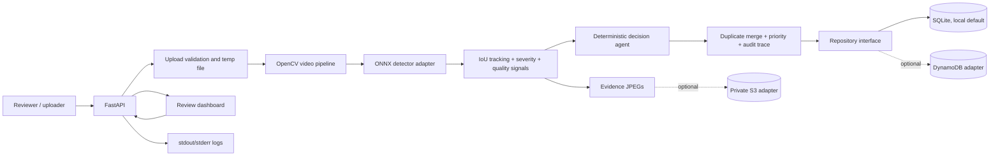
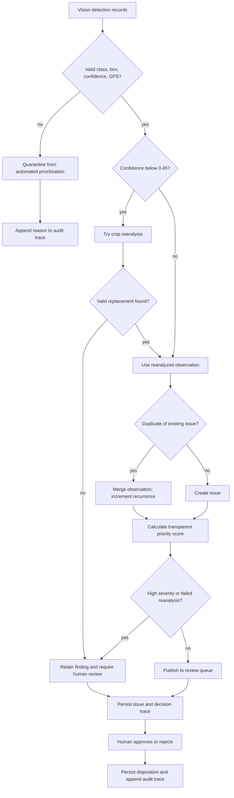

# RoadGuard AI architecture

## Runtime architecture

The ONNX model and its class map must be supplied separately. The tests use an explicitly mocked detector and do not establish model accuracy. S3 and DynamoDB adapters exist but require external AWS configuration and have not been tested against a live account in this review.

## Agent workflow

All decisions are deterministic rules, not LLM judgments. Priority and severity are triage heuristics and must not be treated as validated engineering or safety assessments. A human reviewer retains final disposition.
